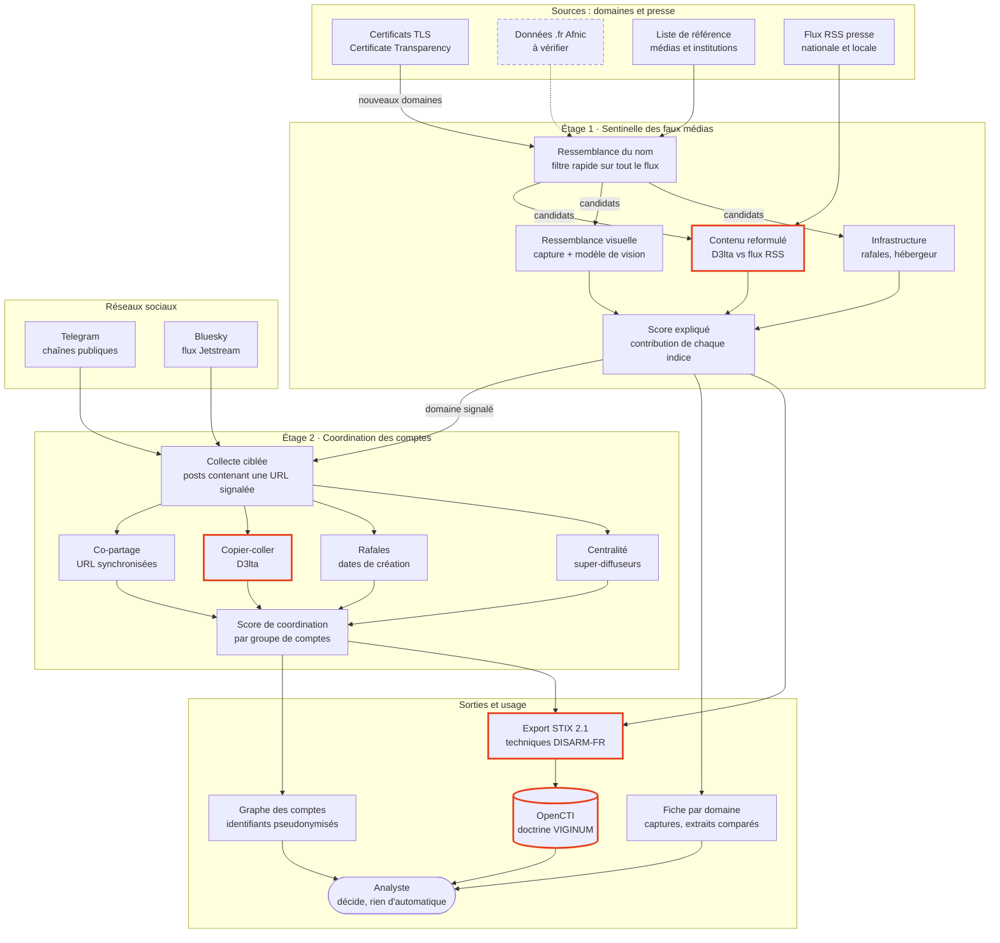

# eidolon

> *εἴδωλον* (eidōlon) : en grec, le double, l'image trompeuse qui imite le réel.
> Les faux médias sont des eidola : des copies faites pour être prises pour l'original.

**eidolon** détecte tôt les sites qui usurpent l'identité de médias (nationaux ou locaux), puis cartographie les réseaux de comptes qui les amplifient. Le résultat est un score expliqué et un export STIX 2.1 importable dans OpenCTI.

Projet préparé pour le **hackathon Artefact Adopt AI « Désinformation et souveraineté démocratique »**, *Challenge 1 : Détecter et caractériser des menaces informationnelles et cyber* (3 jours sur place, préparation en amont).

> **Statut :** cadrage. Ce dépôt consolide les premières pistes ; aucune ligne de code produit n'est encore écrite, en dehors d'un script d'inventaire des données.

---

## Le problème

Les campagnes d'ingérence numérique étrangère documentées par VIGINUM suivent souvent le même schéma :

1. **préparer l'infrastructure** : enregistrer des domaines qui imitent de vrais médias (`spiegel[.]ltd`, `20minuts[.]com`… pour RRN/Doppelgänger ; plus de 100 faux sites de presse locale en `.fr` lors des municipales 2026) ;
2. **produire le contenu** : articles plagiés, traduits ou reformulés par IA ;
3. **amplifier** : réseaux de comptes inauthentiques qui partagent les liens.

Aujourd'hui, la détection intervient surtout à l'étape 3, quand la campagne est déjà visible. **eidolon vise l'étape 1**, puis remonte vers l'étape 3 à partir des domaines détectés.

## La solution en une phrase

Une **sentinelle** qui surveille l'apparition de nouveaux domaines, repère ceux qui ressemblent à un média français, vérifie s'ils republient du contenu reformulé, puis un **module de coordination** qui identifie les comptes partageant leurs liens de façon synchronisée.

## Les briques du projet

> **Version interactive :** [`docs/architecture-interactive.html`](docs/architecture-interactive.html). Survol pour voir les liens, clic pour le détail de chaque brique (outils, techniques DISARM, moment de préparation), filtres par étage. GitHub n'affiche pas les pages HTML d'un dépôt privé : clone le dépôt et ouvre le fichier dans un navigateur.



**Légende :** bordure vermillon = brique qui réutilise un outil ou un format de VIGINUM (D3lta, DISARM-FR, doctrine OpenCTI) ; pointillés = source à vérifier.

Briques transverses et bonus, hors du schéma :

| Brique | Rôle | Statut |
|---|---|---|
| Données VIGINUM (RRN, Portal Kombat, STIX) | Vérité terrain | Disponible, voir `scripts/inventaire_donnees_viginum.py` |
| Évaluation | Rejeu historique RRN (part détectée, jours d'avance) ; chaînes Portal Kombat retrouvées | À préparer avant le hackathon |
| Journal des collectes | Trace de chaque collecte de l'étage 2 (délibération CNIL 2025-108) | J2 |
| Assistant d'analyse | Fiche DISARM rédigée par un modèle ouvert à partir des sorties | Bonus |
| Narratifs RU → FR | Mode traduction de D3lta sur les sites Portal Kombat | Bonus |

Détails : [docs/architecture.md](docs/architecture.md).

## Pourquoi ce projet

| Attente du challenge | Réponse d'eidolon |
|---|---|
| Identifier tôt | Détection au moment de l'enregistrement du domaine, avant l'amplification |
| Déterminer l'origine | Liens d'infrastructure entre domaines (rafales, hébergeur, bureau d'enregistrement) |
| Modéliser la propagation | Graphe de co-partage des comptes qui diffusent les liens |
| Volet « cyber » | Surveillance des journaux de certificats TLS, typosquatting |

Ce qui devrait parler à un jury institutionnel :

- **réutilisation des briques VIGINUM** : jeux de domaines publiés, outil D3lta, référentiel DISARM-FR, doctrine OpenCTI ;
- **neutralité** : on caractérise des comportements et des usurpations d'identité, jamais la véracité d'une opinion ;
- **sobriété en données personnelles** : l'étage 1 n'en traite quasiment pas ; l'étage 2 ne collecte que les publications contenant une URL déjà signalée (voir [docs/conformite-cnil.md](docs/conformite-cnil.md)) ;
- **souveraineté** : modèles ouverts exécutables sur place, pas d'appel à des API extra-européennes, code open source ;
- **analyste dans la boucle** : un score détaillé indice par indice, aucune action automatique.

## Évaluation prévue

- **Test sur des cas réels (RRN) :** sur les 637 domaines publiés par VIGINUM (créés entre 2022 et 2025), combien auraient été repérés, et avec combien de jours d'avance sur leur signalement ?
- **Coordination (Portal Kombat) :** la méthode retrouve-t-elle les chaînes Telegram listées par VIGINUM ?
- **Démo en direct :** flux de certificats du jour, plus une rediffusion de données historiques (résultat garanti).

## Organisation du dépôt

```
README.md                      ce fichier
docs/
  contexte.md                  challenge, cadre juridique et institutionnel, menace observée
  donnees.md                   inventaire des ressources fournies et des sources externes
  architecture.md              les deux étages, indices, sorties, choix techniques
  architecture-interactive.html  diagramme interactif des briques (à ouvrir dans un navigateur)
  conformite-cnil.md           application de la délibération CNIL 2025-108
  plan.md                      préparation en amont / 3 jours sur place / répartition
  pistes-ecartees.md           idées étudiées et raisons de les écarter ou de les reporter
  questions-ouvertes.md        ce qu'il reste à trancher
scripts/
  inventaire_donnees_viginum.py   compte les domaines, comptes et techniques DISARM des rapports VIGINUM
```

## Démarrage rapide

```bash
git clone https://github.com/VIGINUM-FR/Rapports-Techniques.git data/viginum
python scripts/inventaire_donnees_viginum.py data/viginum
```

## Équipe

À compléter.
